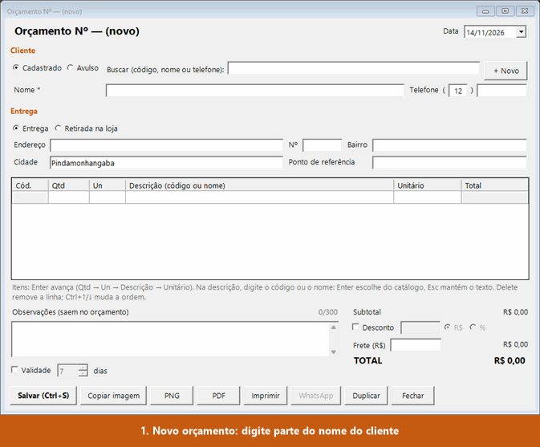
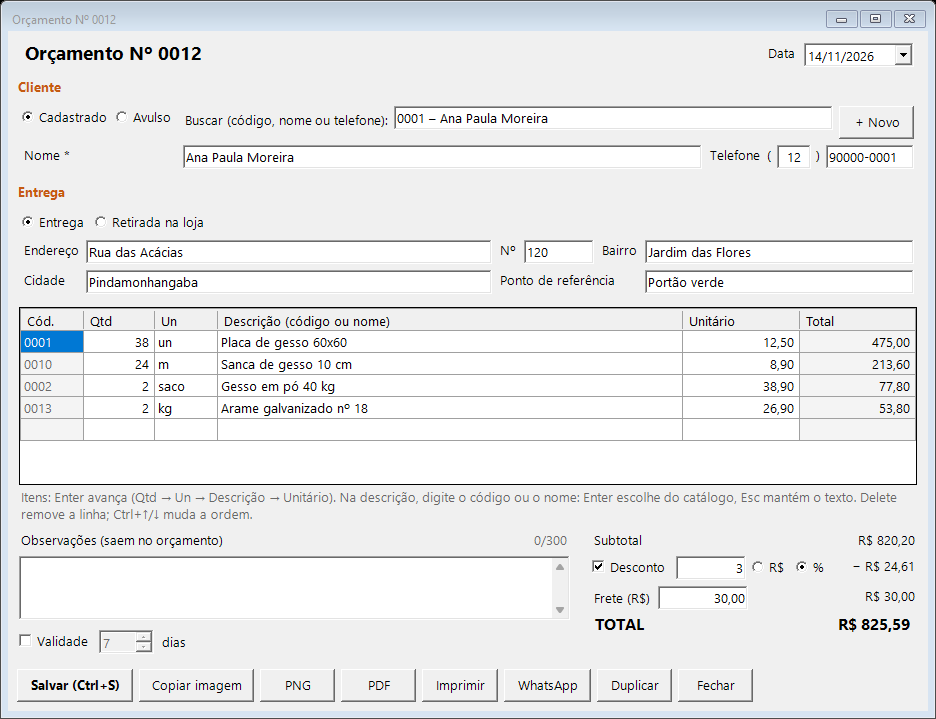
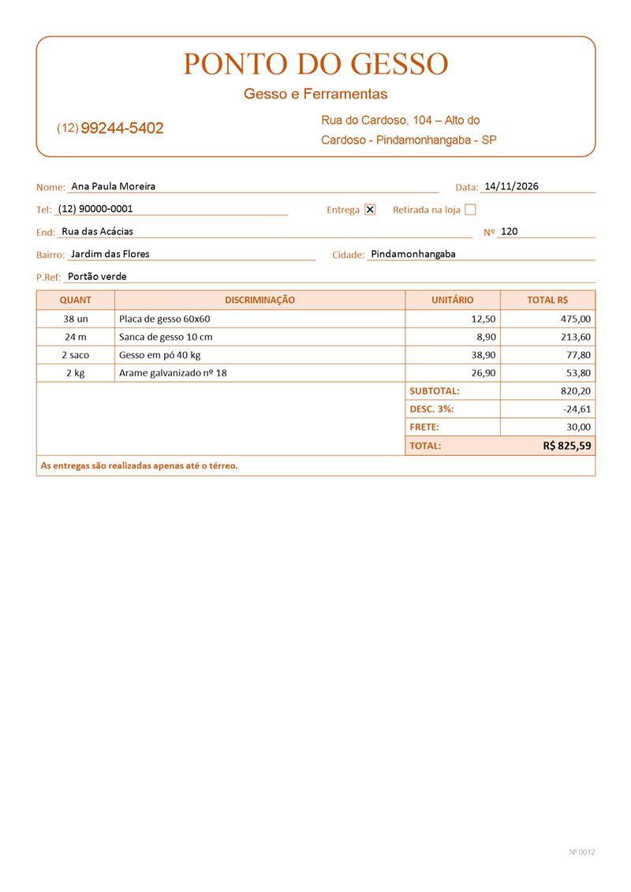
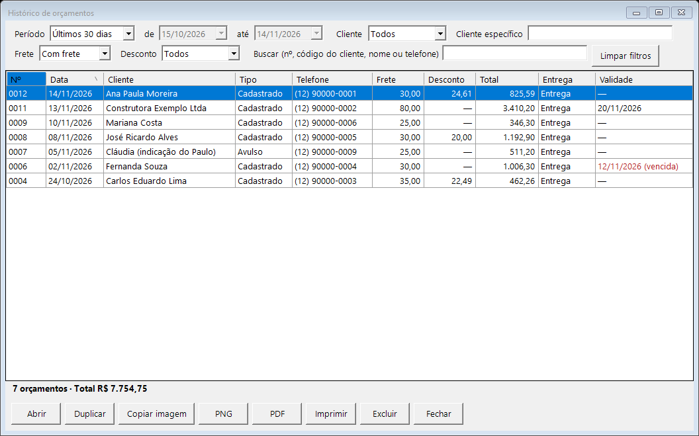
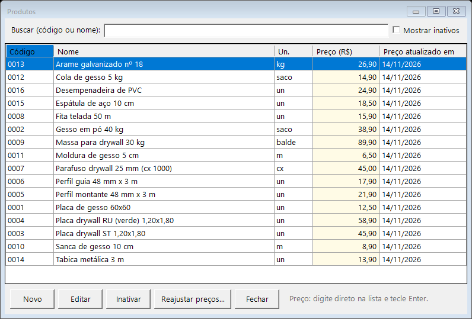

# Ponto do Gesso — app de orçamentos

App desktop que substituiu o talão de papel nos orçamentos da loja **Ponto do Gesso** (Gesso e Ferramentas — Pindamonhangaba/SP). Roda até no **Windows 7** do PC da loja.

<h2>⬇️ Baixar</h2>

<p align="center">
  <a href="https://github.com/LuccaBueno/orcamentos-ponto-do-gesso/releases/latest/download/PontoDoGesso.zip">
    
  </a>
</p>

<ol>
  <li>Clique no botão acima para baixar o <code>PontoDoGesso.zip</code>.</li>
  <li>Clique com o botão direito no arquivo baixado → <b>Extrair tudo...</b> → digite <code>C:\</code> e clique em <b>Extrair</b>.</li>
  <li>Abra <code>C:\PontoDoGesso\PontoDoGesso.exe</code>. Se aparecer <b>"O Windows protegeu o computador"</b>, clique em <b>Mais informações › Executar assim mesmo</b> (o app ainda não tem assinatura digital).</li>
</ol>

<blockquote>
  ⚠️ Não baixe <b>"Source code (zip)"</b> nem <b>"Source code (tar.gz)"</b>: isso é o código-fonte para programadores, não o app.<br>
  No Windows 7, instale antes o .NET Framework 4.8 — veja <a href="docs/INSTALACAO-WINDOWS7.md">docs/INSTALACAO-WINDOWS7.md</a>.
</blockquote>

[](https://github.com/LuccaBueno/orcamentos-ponto-do-gesso/actions/workflows/build.yml)

<p align="center">
  
  <br><sub>Orçamento do zero até a imagem pronta para o WhatsApp (dados fictícios do modo de demonstração).</sub>
</p>

## O problema

Os orçamentos eram escritos à mão num talão de papel: a conta era feita na calculadora, para mandar pelo WhatsApp só restava fotografar a folha e nada ficava guardado para consultar depois. Achar um orçamento antigo ou refazer um parecido para outra obra significava folhear talões.

## A solução

Um app simples de balcão, pensado para quem não é da área de tecnologia:

- o orçamento é feito pelo teclado, com o cliente e os produtos sugeridos enquanto se digita, e as contas são feitas pelo app;
- a imagem sai **no mesmo visual da folha de papel** que os clientes já conhecem, pronta para colar no WhatsApp Web com `Ctrl+V`;
- tudo fica guardado no próprio computador, com histórico, filtros e backup automático;
- o app se atualiza sozinho pelo botão **Verificar atualizações**, sem ninguém precisar ir até a loja.

## Funcionalidades

| | |
|---|---|
|  | **Orçamento** para cliente cadastrado ou avulso, entrega ou retirada, itens com sugestão do catálogo (por código ou nome), desconto opcional em R$ ou %, frete, validade opcional e observações. |
|  | **Saída** em A4 retrato, igual à folha em papel: **Copiar imagem**, PNG, PDF, impressão com pré-visualização e botão **WhatsApp**, que abre a conversa com o cliente. |
|  | **Histórico** com filtros combináveis (período, cadastrado/avulso, cliente, frete, desconto, texto), soma dos valores e ações para reabrir, duplicar e exportar de novo. |
|  | **Produtos** com preço editável direto na lista e reajuste em lote; **clientes** com busca sem acento e aviso de duplicado. |

E também: backup automático diário (com pasta extra para pendrive) e restauração, configurações dos dados da loja no cabeçalho, atalhos de teclado, manual (`F1`), **modo de demonstração** com dados fictícios e tela de diagnóstico para suporte.

Manual completo: [docs/MANUAL.md](docs/MANUAL.md).

## Stack

| Parte | Escolha |
|---|---|
| Linguagem e interface | C# + **WinForms** sobre **.NET Framework 4.8**, x86 |
| Dados | **SQLite** (`System.Data.SQLite`) + **Dapper**, migrações embutidas no exe |
| PDF, PNG e impressão | **PDFsharp** 6.2.4 (variante GDI, última versão MIT) e `System.Drawing` |
| Testes | **xUnit** (cálculos, banco, exportação e telas WinForms) |
| CI/CD | **GitHub Actions**: compila e testa a cada push; a tag `vX.Y.Z` gera o zip, o `.sha256` e a Release |

Sem instalador, sem serviço em segundo plano e sem telemetria: a única chamada de rede do app é a verificação de versão nova no GitHub. Detalhes em [docs/ARQUITETURA.md](docs/ARQUITETURA.md).

## Como instalar

1. **Windows 7:** instalar uma vez o .NET Framework 4.8 ([passo a passo](docs/INSTALACAO-WINDOWS7.md)). No Windows 10 e 11 ele já vem instalado.
2. Baixar o [`PontoDoGesso.zip`](https://github.com/LuccaBueno/orcamentos-ponto-do-gesso/releases/latest/download/PontoDoGesso.zip), extrair em `C:\` e abrir `C:\PontoDoGesso\PontoDoGesso.exe`.
3. Os dados ficam em `%APPDATA%\PontoDoGesso\`, fora da pasta do app: atualizar ou trocar a pasta não apaga nada.

| Item | Requisito |
|---|---|
| Sistema | Windows 7 SP1, 8.1, 10 e 11 (32 ou 64 bits) |
| Runtime | .NET Framework 4.8 |
| Instalação | Portátil: descompactar a pasta e abrir `PontoDoGesso.exe` |

## Como rodar o código

Pré-requisitos: Windows 10/11, [.NET SDK](https://dotnet.microsoft.com/download) 8 ou mais novo e Git. O pacote de referência do .NET Framework 4.8 vem pelo NuGet, então não precisa de Visual Studio.

```powershell
git clone https://github.com/LuccaBueno/orcamentos-ponto-do-gesso.git
cd orcamentos-ponto-do-gesso
dotnet build PontoDoGesso.sln -c Debug
dotnet test  PontoDoGesso.sln
.\src\PontoDoGesso\bin\x86\Debug\net48\PontoDoGesso.exe
```

- Para não mexer nos seus dados, defina `PONTODOGESSO_DADOS` com outra pasta antes de abrir o app (os testes gravam tudo em `.tmp\`).
- `scripts\empacotar.ps1` gera o zip da release; `scripts\gerar-prints.ps1` refaz os prints e o GIF deste README com o modo de demonstração.

## Documentação

| Documento | Conteúdo |
|---|---|
| [docs/MANUAL.md](docs/MANUAL.md) | Manual do usuário |
| [docs/ARQUITETURA.md](docs/ARQUITETURA.md) | Stack, estrutura de pastas, banco de dados, regras de cálculo |
| [docs/LAYOUT-ORCAMENTO.md](docs/LAYOUT-ORCAMENTO.md) | Especificação visual do PDF/PNG (baseada na folha em papel) |
| [docs/ATUALIZACAO.md](docs/ATUALIZACAO.md) | Como funciona o botão de atualização e como publicar versões |
| [docs/INSTALACAO-WINDOWS7.md](docs/INSTALACAO-WINDOWS7.md) | Instalar e testar no PC da loja com Windows 7 |
| [docs/COMO-COMECAR.md](docs/COMO-COMECAR.md) | Preparar o PC de desenvolvimento |
| [docs/fases/](docs/fases/) | Plano de desenvolvimento em fases |
| [CHANGELOG.md](CHANGELOG.md) | Histórico de versões |

## Status e licença

Fase 10 (polimento) em andamento: falta o teste no Windows 7 da loja para publicar a v1.0.0 — ver [docs/fases/README.md](docs/fases/README.md).

Licença [MIT](LICENSE).
