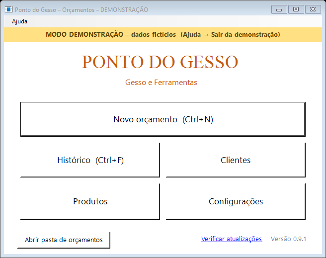
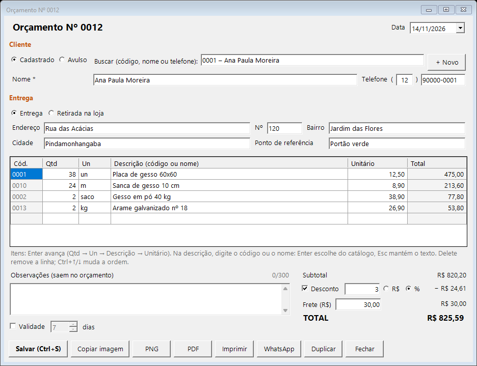
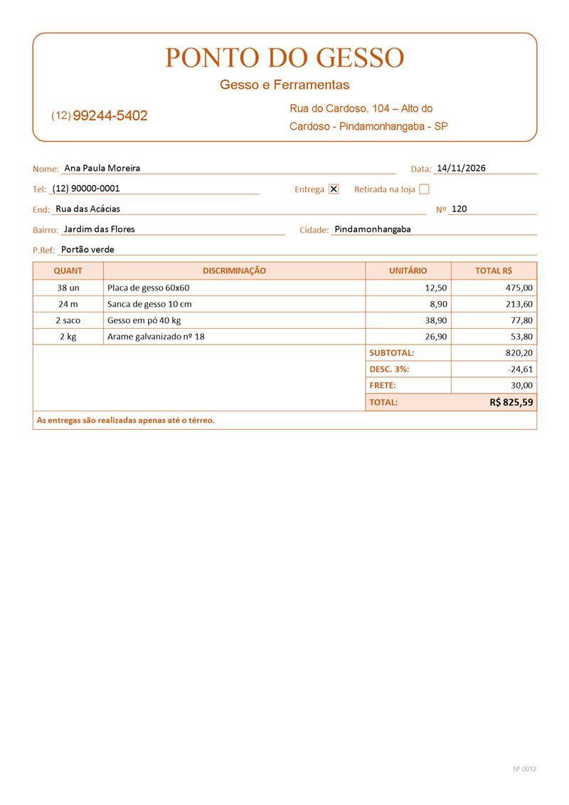
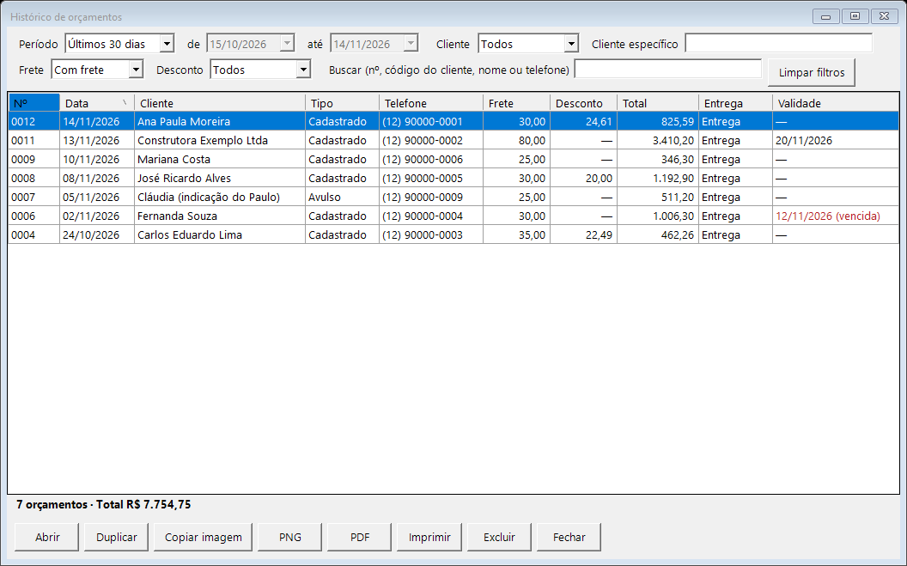
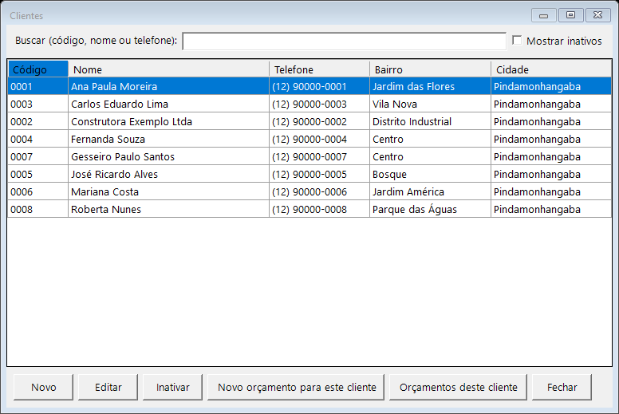
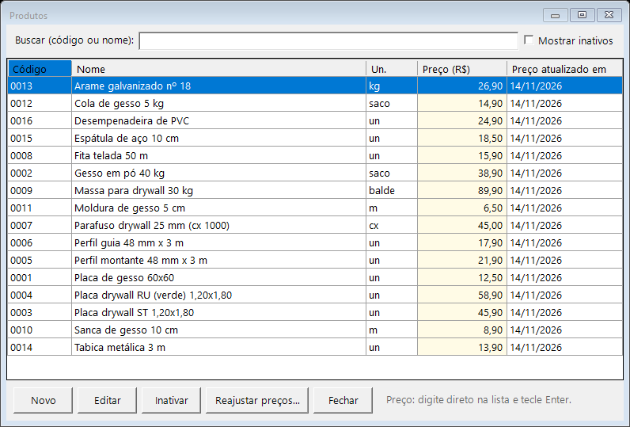
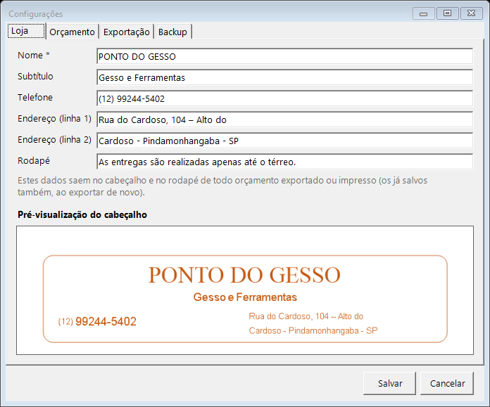

# Manual do Ponto do Gesso

Guia curto para quem usa o app no balcão. Os prints são do **modo de demonstração** (nomes, telefones e endereços inventados).

> Para abrir este manual pelo app: aperte **F1** em qualquer janela, ou **Ajuda → Manual do usuário**.

## Sumário

1. [Tela principal](#1-tela-principal)
2. [Fazer um orçamento](#2-fazer-um-orçamento)
3. [Mandar para o cliente: imagem, PDF, impressão e WhatsApp](#3-mandar-para-o-cliente)
4. [Histórico](#4-histórico)
5. [Clientes](#5-clientes)
6. [Produtos e preços](#6-produtos-e-preços)
7. [Configurações e backup](#7-configurações-e-backup)
8. [Atualizar o app](#8-atualizar-o-app)
9. [Atalhos do teclado](#9-atalhos-do-teclado)
10. [Modo de demonstração](#10-modo-de-demonstração)
11. [Quando algo dá errado](#11-quando-algo-dá-errado)

## 1. Tela principal

- **Novo orçamento** (`Ctrl+N`), **Histórico** (`Ctrl+F`), **Clientes**, **Produtos** e **Configurações**.
- Embaixo: **Abrir pasta de orçamentos** (onde ficam os PNG e PDF), **Verificar atualizações** e a versão instalada.
- Quando sai uma versão nova, aparece em laranja **Nova versão X!** no rodapé.

## 2. Fazer um orçamento

1. **Cliente**
   - **Cadastrado:** digite parte do nome, o telefone ou o código e escolha na lista (setas + `Enter`). Nome, telefone e endereço são preenchidos sozinhos e podem ser mudados só neste orçamento.
   - Cliente novo: **+ Novo** abre o cadastro.
   - **Avulso:** só nome e telefone, sem cadastro. Ao salvar pela primeira vez, o app pergunta se quer cadastrar (dá para desligar em Configurações).
   - Se o cliente tiver uma observação interna (ex.: "pede tudo discriminado"), ela aparece numa faixa amarela. Ela **não** sai no orçamento.
2. **Entrega** ou **Retirada na loja**. Na entrega, confira endereço, número, bairro, cidade e ponto de referência.
3. **Itens:** digite a quantidade e tecle `Enter`; na descrição, digite o **código** ou parte do **nome** do produto e escolha na lista. Unidade e preço vêm do catálogo e podem ser mudados só neste orçamento. Para um item fora do catálogo, é só digitar a descrição e o preço e apertar `Esc` na lista.
   - Quantidade aceita vírgula (`2,5`).
   - `Delete` apaga a linha; `Ctrl+↑` e `Ctrl+↓` mudam a ordem.
4. **Observações** (saem impressas, até 300 letras), **Validade** (opcional, em dias), **Desconto** (opcional, em R$ ou %, só sobre os produtos) e **Frete**.
5. **Salvar** (`Ctrl+S`). O número do orçamento (`Nº 0001`, `0002`…) sai no primeiro salvamento.

Outros botões: **Duplicar** (mesmo orçamento com a data de hoje, para outro cliente ou outra obra) e **Fechar** (pergunta se quer salvar o que mudou). `Ctrl+N` começa outro orçamento na mesma janela.

> Mudar o cadastro do cliente ou o preço de um produto **não** muda orçamentos que já foram feitos: cada orçamento guarda uma cópia dos dados.

## 3. Mandar para o cliente

Todos os botões salvam o orçamento antes, se for preciso.

| Botão | Atalho | O que faz |
|---|---|---|
| **Copiar imagem** | `Ctrl+Shift+C` | Copia o orçamento como imagem. No WhatsApp Web, abra a conversa e aperte `Ctrl+V`. |
| **PNG** | | Salva a imagem na pasta de orçamentos. |
| **PDF** | `Ctrl+E` | Salva o PDF (A4) na pasta de orçamentos. |
| **Imprimir** | `Ctrl+P` | Mostra a página antes de imprimir. |
| **WhatsApp** | | Salva o PNG, abre a pasta com o arquivo selecionado e abre a conversa com o cliente no navegador: é só arrastar a imagem. |

É assim que o cliente recebe:

Os arquivos ficam em `Documentos\Orçamentos Ponto do Gesso\ANO\MÊS\`, com nomes como `Orc-0012_Ana-Paula-Moreira_14-11-2026.pdf`.

## 4. Histórico

- Filtros: período, só cadastrados ou só avulsos, um cliente específico, com/sem frete, com/sem desconto e busca por número, código do cliente, nome ou telefone. Os filtros ficam lembrados até fechar o app; **Limpar filtros** volta tudo.
- Embaixo, a quantidade de orçamentos e a soma dos totais.
- `Enter` ou duplo clique abre o orçamento. Também dá para **Duplicar**, **Copiar imagem**, salvar **PNG**/**PDF**, **Imprimir** e **Excluir**.
- A validade vencida aparece em vermelho.

## 5. Clientes

- A busca aceita nome, telefone ou código. `Enter` abre o primeiro da lista.
- **Novo orçamento para este cliente** e **Orçamentos deste cliente** (abre o histórico filtrado).
- Clientes não são apagados: **Inativar** tira da busca, mas os orçamentos antigos continuam lá. **Mostrar inativos** mostra todos.

## 6. Produtos e preços

- **Preço:** clique no preço na lista, digite o novo e tecle `Enter`.
- **Reajustar preços…** aumenta ou diminui vários produtos de uma vez (em % ou R$), com prévia antes de aplicar.
- Como nos clientes, produtos são **inativados**, não apagados.

## 7. Configurações e backup

- **Loja:** nome, subtítulo, telefone, endereço e rodapé que saem no orçamento, com prévia.
- **Orçamento:** validade sugerida e se pergunta para cadastrar cliente avulso.
- **Exportação:** pasta dos orçamentos e impressora padrão.
- **Backup:** o app faz um backup sozinho uma vez por dia, ao abrir, e guarda os últimos 30. Ali também estão **Fazer backup agora**, **Copiar backup para…** (pendrive), uma **pasta extra** opcional que recebe uma cópia de cada backup e **Restaurar backup…**.

> **Recomendado:** escolher um pendrive ou HD externo como pasta extra de backup. Se o PC estragar, os dados estão lá.

Os dados ficam em `C:\Users\<usuário>\AppData\Roaming\PontoDoGesso\`. Em **Ajuda → Sobre** aparece a pasta exata, com o botão **Abrir pasta de dados**.

## 8. Atualizar o app

- O app confere uma vez por dia se há versão nova (precisa de internet). Se houver, aparece **Nova versão X!** no rodapé.
- **Verificar atualizações** → **Atualizar agora**: o app baixa, confere o arquivo, faz backup dos dados, fecha e abre de novo já atualizado. Os dados não se perdem.
- Se algo der errado, o app volta sozinho para a versão anterior.

Detalhes em [ATUALIZACAO.md](ATUALIZACAO.md).

## 9. Atalhos do teclado

| Atalho | Onde | O que faz |
|---|---|---|
| `Ctrl+N` | Tela principal / orçamento | Novo orçamento |
| `Ctrl+S` | Orçamento | Salvar |
| `Ctrl+Shift+C` | Orçamento | Copiar imagem |
| `Ctrl+P` | Orçamento | Imprimir |
| `Ctrl+E` | Orçamento | Salvar PDF |
| `Ctrl+F` | Tela principal | Abrir o histórico |
| `Ctrl+F` | Orçamento, clientes, produtos, histórico | Ir para a busca |
| `F1` | Qualquer janela | Abrir este manual |
| `Enter` | Itens do orçamento | Próxima coluna |
| `Esc` | Lista de sugestões | Fechar a lista e manter o que foi digitado |

## 10. Modo de demonstração

**Ajuda → Dados de demonstração** troca para um banco separado, com clientes, produtos e orçamentos **inventados**, para mostrar o app ou treinar sem mexer nos dados de verdade. Aparece a faixa amarela **MODO DEMONSTRAÇÃO** na tela principal.

**Ajuda → Sair da demonstração** volta aos dados reais (que não são tocados). Ao abrir o app de novo, ele sempre começa com os dados reais.

## 11. Quando algo dá errado

- As mensagens explicam o problema em português. Os detalhes técnicos vão para `logs\erros_AAAA-MM.log`, dentro da pasta de dados.
- **Ajuda → Diagnóstico** mostra a versão do Windows, do .NET e do banco, e tem botões para testar o banco, o PDF/PNG e a conexão com o GitHub. **Copiar informações** copia tudo para mandar a quem for ajudar.
- Instalação no Windows 7 e antivírus: [INSTALACAO-WINDOWS7.md](INSTALACAO-WINDOWS7.md).
