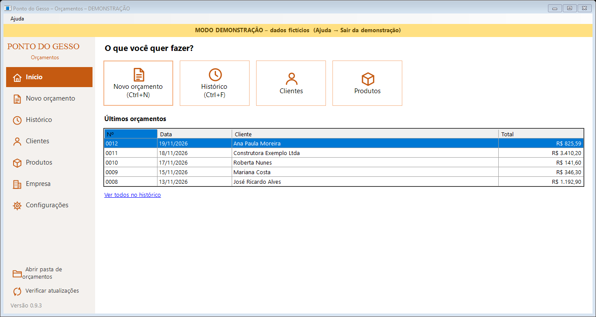
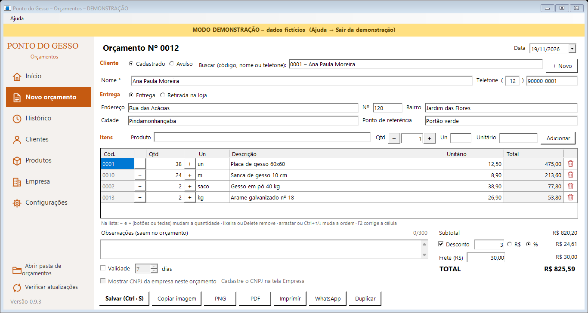
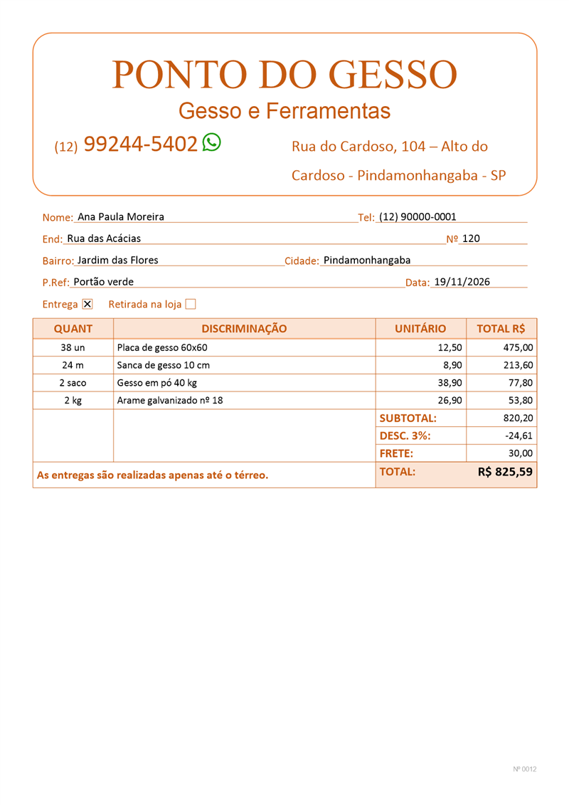
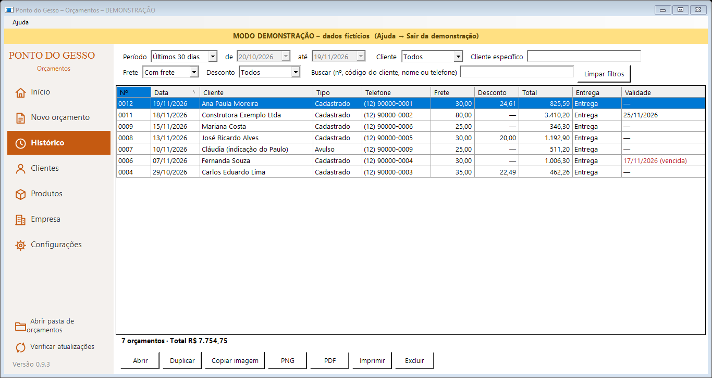
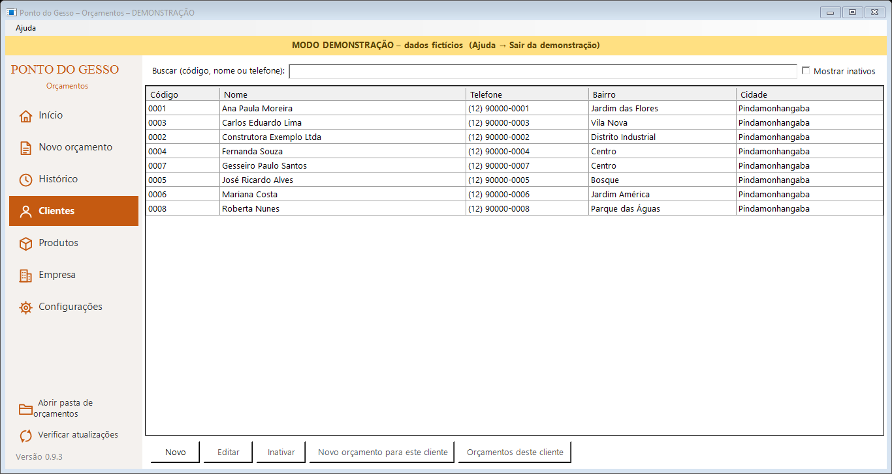
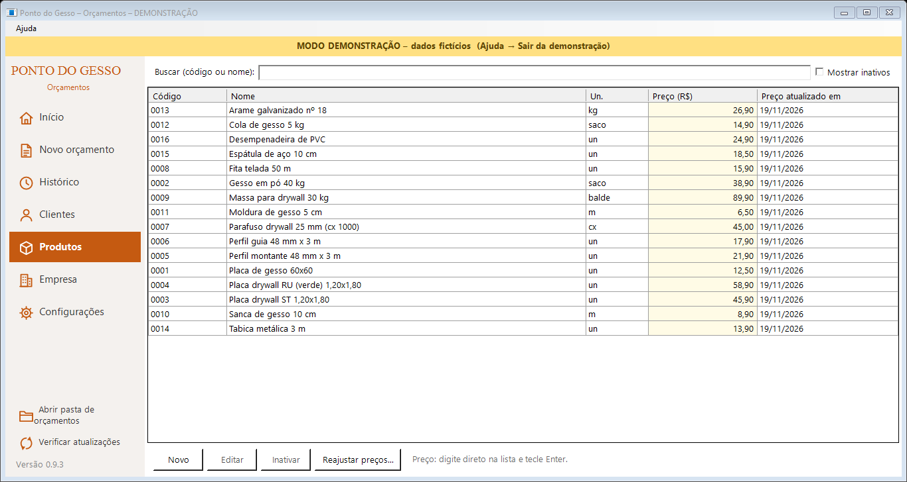
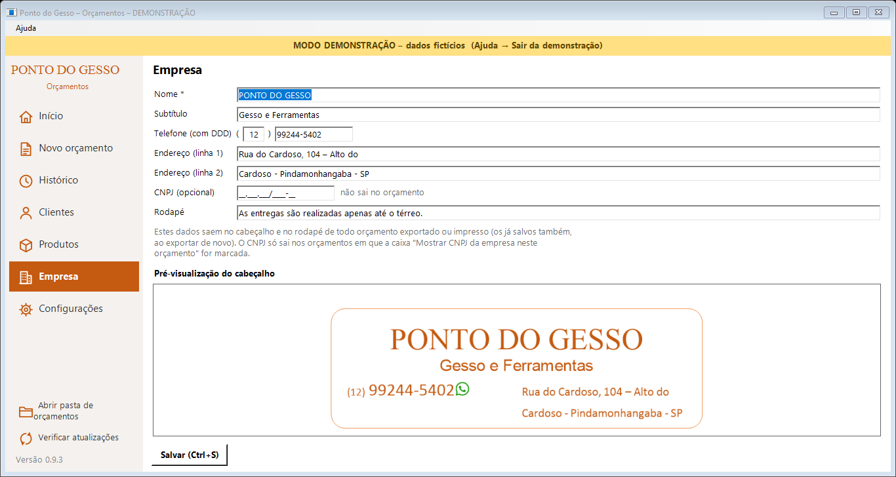
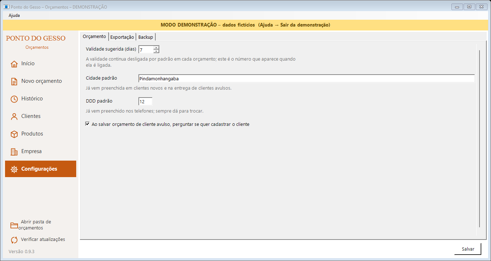

# Manual do Ponto do Gesso

Guia curto para quem usa o app no balcão. Os prints são do **modo de demonstração** (nomes, telefones e endereços inventados).

> Para abrir este manual pelo app: aperte **F1** em qualquer janela, ou **Ajuda → Manual do usuário**.

## Sumário

1. [Tela principal](#1-tela-principal)
2. [Fazer um orçamento](#2-fazer-um-orçamento)
3. [Mandar para o cliente: imagem, PDF, impressão e WhatsApp](#3-mandar-para-o-cliente)
4. [Histórico](#4-histórico)
5. [Clientes](#5-clientes)
6. [Produtos e preços](#6-produtos-e-preços)
7. [Empresa, configurações e backup](#7-empresa-configurações-e-backup)
8. [Atualizar o app](#8-atualizar-o-app)
9. [Atalhos do teclado](#9-atalhos-do-teclado)
10. [Modo de demonstração](#10-modo-de-demonstração)
11. [Quando algo dá errado](#11-quando-algo-dá-errado)

## 1. Tela principal

O app tem **uma janela só**. À esquerda fica o **menu lateral**, sempre à vista; o item da tela atual fica em laranja. Clicar num item troca a tela da direita, sem abrir janela nova:

- **Início** (a tela que aparece ao abrir): atalhos grandes e os **últimos 5 orçamentos** (`Enter` ou clique duplo abre).
- **Novo orçamento** (`Ctrl+N`), **Histórico** (`Ctrl+F`), **Clientes**, **Produtos**, **Empresa** e **Configurações**.
- Embaixo: **Abrir pasta de orçamentos** (onde ficam os PNG e PDF), **Verificar atualizações** e a versão instalada. Quando sai uma versão nova, aparece em laranja **Nova versão X!** logo acima da versão.

Se a tela atual tiver alterações não salvas (orçamento, empresa, configurações), ao trocar de tela ou fechar o app aparece **Salvar**, **Não salvar** ou **Cancelar** (Cancelar fica onde está).

## 2. Fazer um orçamento

1. **Cliente**
   - **Cadastrado:** digite parte do nome, o telefone ou o código e escolha na lista (setas + `Enter`, ou clique). Nome, telefone e endereço são preenchidos sozinhos e podem ser mudados só neste orçamento. Escolhido pelo teclado, o cursor já vai para o **Produto**.
   - Cliente novo: **+ Novo** abre o cadastro.
   - **Avulso:** só nome e telefone, sem cadastro. Ao salvar pela primeira vez, o app pergunta se quer cadastrar (dá para desligar em Configurações).
   - Se o cliente tiver uma observação interna (ex.: "pede tudo discriminado"), ela aparece numa faixa amarela. Ela **não** sai no orçamento.
2. **Entrega** ou **Retirada na loja**. Na entrega, confira endereço, número, bairro, cidade e ponto de referência.
3. **Itens**, na barra acima da lista: **Produto · − Qtd + · Un · Unitário · Adicionar**.
   - No **Produto**, digite parte do **nome** ou o **código**: aparece a lista do catálogo. Escolha com as setas e `Enter`, ou clique. Unidade e preço vêm do catálogo e o cursor vai para a **quantidade**.
   - Quantidade: digite (aceita vírgula, `2,5`) ou use **−** e **+** (os botões, as teclas `+` e `−` ou as setas ↑ e ↓).
   - `Enter` vai para o Unitário e, de novo, **adiciona** o item (ou clique em **Adicionar**). A barra fica limpa e o cursor volta para o Produto, pronto para o próximo. Exemplo: `placa` `Enter` `12` `Enter` `Enter`.
   - Item fora do catálogo: digite a descrição, `Esc` fecha a lista se ela aparecer, e preencha quantidade, unidade e preço.
   - `Esc` com a lista fechada limpa a barra.
   - **Na lista**, cada item tem **−**, **+** e a **lixeira**. Com um item selecionado: teclas `+` e `−` mudam a quantidade, `Delete` remove, `Ctrl+↑`/`Ctrl+↓` (ou arrastar com o mouse) mudam a ordem. Quantidade, descrição e preço podem ser corrigidos na própria lista (`F2` ou começar a digitar). Mudar o preço aqui não muda o catálogo.
4. **Observações** (saem impressas, até 300 letras), **Validade** (opcional, em dias), **Desconto** (opcional, em R$ ou %, só sobre os produtos) e **Frete**.
5. **Mostrar CNPJ da empresa neste orçamento:** vem **desmarcada** em todo orçamento novo. Marcada, o CNPJ sai no cabeçalho, abaixo do endereço. Se estiver cinza, cadastre o CNPJ em **Configurações → Empresa**.
6. **Data:** orçamento novo usa a data de hoje do Windows e muda sozinho para hoje se o dia virar com a tela aberta. Dá para escolher outra data no calendário; aí aparece **data alterada manualmente** e o app não mexe mais. Orçamento já salvo mantém a data dele.
7. **Salvar** (`Ctrl+S`). O número do orçamento (`Nº 0001`, `0002`…) sai no primeiro salvamento. Se ficou um item digitado na barra sem clicar em Adicionar, ele entra antes de salvar.

Outros botões: **Duplicar** (mesmo orçamento, sem número, com a data de hoje e o CNPJ desmarcado, para outro cliente ou outra obra). `Ctrl+N` começa outro orçamento na mesma tela (pergunta antes se houver alterações).

> Mudar o cadastro do cliente ou o preço de um produto **não** muda orçamentos que já foram feitos: cada orçamento guarda uma cópia dos dados.

## 3. Mandar para o cliente

Todos os botões salvam o orçamento antes, se for preciso.

| Botão | Atalho | O que faz |
|---|---|---|
| **Copiar imagem** | `Ctrl+Shift+C` | Copia o orçamento como imagem. No WhatsApp Web, abra a conversa e aperte `Ctrl+V`. |
| **PNG** | | Salva a imagem na pasta de orçamentos. |
| **PDF** | `Ctrl+E` | Salva o PDF (A4) na pasta de orçamentos. |
| **Imprimir** | `Ctrl+P` | Mostra a página antes de imprimir. |
| **WhatsApp** | | Salva o PNG, abre a pasta com o arquivo selecionado e abre a conversa com o cliente no navegador: é só arrastar a imagem. |

É assim que o cliente recebe:

Os arquivos ficam em `Documentos\Orçamentos Ponto do Gesso\ANO\MÊS\`, com nomes como `Orc-0012_Ana-Paula-Moreira_14-11-2026.pdf`.

## 4. Histórico

- Filtros: período, só cadastrados ou só avulsos, um cliente específico, com/sem frete, com/sem desconto e busca por número, código do cliente, nome ou telefone. Os filtros ficam lembrados até fechar o app; **Limpar filtros** volta tudo.
- Embaixo, a quantidade de orçamentos e a soma dos totais.
- `Enter` ou duplo clique abre o orçamento (no lugar do histórico; para voltar, clique em **Histórico** no menu). Também dá para **Duplicar**, **Copiar imagem**, salvar **PNG**/**PDF**, **Imprimir** e **Excluir**.
- A validade vencida aparece em vermelho.

## 5. Clientes

- A busca aceita nome, telefone ou código. `Enter` abre o primeiro da lista.
- **Novo orçamento para este cliente** e **Orçamentos deste cliente** (histórico filtrado) trocam a tela.
- Clientes não são apagados: **Inativar** tira da busca, mas os orçamentos antigos continuam lá. **Mostrar inativos** mostra todos.

## 6. Produtos e preços

- **Preço:** clique no preço na lista, digite o novo e tecle `Enter`.
- **Reajustar preços…** aumenta ou diminui vários produtos de uma vez (em % ou R$), com prévia antes de aplicar.
- Como nos clientes, produtos são **inativados**, não apagados.

## 7. Empresa, configurações e backup

**Empresa** (no menu lateral): nome, subtítulo, telefone (com DDD), endereço em 2 linhas, **CNPJ** (opcional; o app confere os números) e o rodapé que saem no orçamento. Embaixo aparece como o cabeçalho vai ficar, enquanto se digita. Clique em **Salvar** (`Ctrl+S`). O CNPJ só sai nos orçamentos em que a caixa **Mostrar CNPJ** for marcada.

- **Orçamento:** validade sugerida, cidade e DDD padrão e se pergunta para cadastrar cliente avulso.
- **Exportação:** pasta dos orçamentos e impressora padrão.
- **Backup:** o app faz um backup sozinho uma vez por dia, ao abrir, e guarda os últimos 30. Ali também estão **Fazer backup agora**, **Copiar backup para…** (pendrive), uma **pasta extra** opcional que recebe uma cópia de cada backup e **Restaurar backup…**.

> **Recomendado:** escolher um pendrive ou HD externo como pasta extra de backup. Se o PC estragar, os dados estão lá.

Os dados ficam em `C:\Users\<usuário>\AppData\Roaming\PontoDoGesso\`. Em **Ajuda → Sobre** aparece a pasta exata, com o botão **Abrir pasta de dados**.

## 8. Atualizar o app

- O app confere uma vez por dia se há versão nova (precisa de internet). Se houver, aparece **Nova versão X!** no rodapé.
- **Verificar atualizações** → **Atualizar agora**: o app baixa, confere o arquivo, faz backup dos dados, fecha e abre de novo já atualizado. Os dados não se perdem.
- Se algo der errado, o app volta sozinho para a versão anterior.

Detalhes em [ATUALIZACAO.md](ATUALIZACAO.md).

## 9. Atalhos do teclado

| Atalho | Onde | O que faz |
|---|---|---|
| `Ctrl+N` | Qualquer tela | Novo orçamento |
| `Ctrl+S` | Orçamento, Empresa | Salvar |
| `Ctrl+Shift+C` | Orçamento | Copiar imagem |
| `Ctrl+P` | Orçamento | Imprimir |
| `Ctrl+E` | Orçamento | Salvar PDF |
| `Ctrl+F` | Início, Empresa, Configurações | Abrir o histórico |
| `Ctrl+F` | Orçamento, clientes, produtos, histórico | Ir para a busca |
| `F1` | Qualquer tela | Abrir este manual |
| `Enter` | Barra de adicionar item | Próximo campo; no Unitário, adiciona o item |
| `+` `−` ou `↑` `↓` | Quantidade da barra | Mudar a quantidade |
| `+` `−` | Lista de itens | Mudar a quantidade do item selecionado |
| `Delete` | Lista de itens | Remover o item selecionado |
| `Ctrl+↑` `Ctrl+↓` | Lista de itens | Mudar a ordem |
| `Esc` | Lista de sugestões | Fechar a lista e manter o que foi digitado |
| `Esc` | Barra de adicionar item | Limpar a barra |

## 10. Modo de demonstração

**Ajuda → Dados de demonstração** troca para um banco separado, com clientes, produtos e orçamentos **inventados**, para mostrar o app ou treinar sem mexer nos dados de verdade. Aparece a faixa amarela **MODO DEMONSTRAÇÃO** na tela principal.

**Ajuda → Sair da demonstração** volta aos dados reais (que não são tocados). Ao abrir o app de novo, ele sempre começa com os dados reais.

## 11. Quando algo dá errado

- As mensagens explicam o problema em português. Os detalhes técnicos vão para `logs\erros_AAAA-MM.log`, dentro da pasta de dados.
- **Ajuda → Diagnóstico** mostra a versão do Windows, do .NET e do banco, e tem botões para testar o banco, o PDF/PNG e a conexão com o GitHub. **Copiar informações** copia tudo para mandar a quem for ajudar.
- Instalação no Windows 7 e antivírus: [INSTALACAO-WINDOWS7.md](INSTALACAO-WINDOWS7.md).
